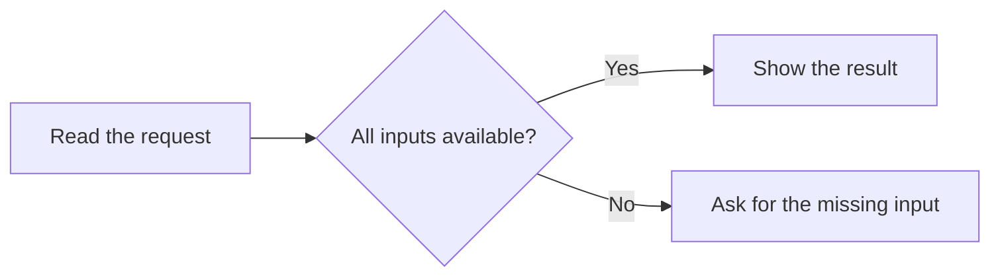
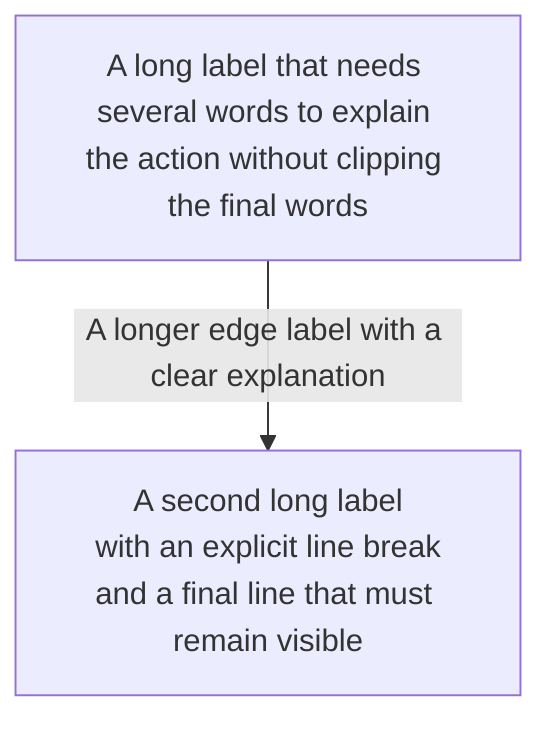
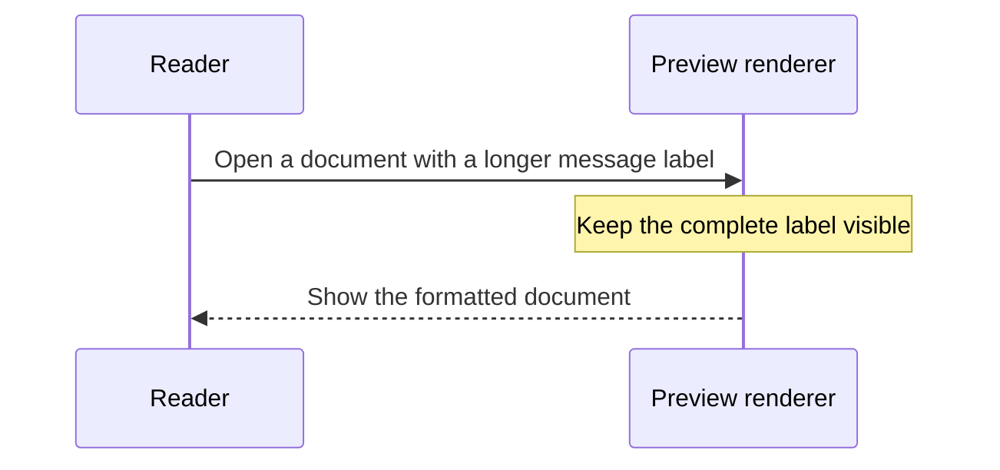

# Preview style

Readable prose uses **Fira Sans**, with *emphasis*, [a link](https://mermaid.js.org/), and `inline_code` in the existing monospace font.

## A short checklist

- Read the request.
- Draw the dependencies.
- Verify the result.

> A preview should stay readable in a narrow pane.

| Element | Expected appearance |
| --- | --- |
| Prose | Fira Sans, 15 px |
| Diagram labels | Fira Sans, 14 px |
| Code | Existing monospace font |

```python
def preview(message: str) -> str:
    return f"Ready: {message}"
```

## Flowchart



## Long labels



## Sequence


